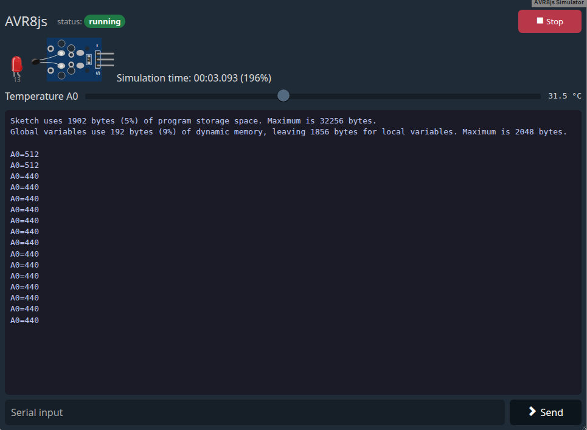

# Edrys AVR8js Module

An AVR8js-based Arduino simulator for [edrys-Lite](https://github.com/edrys-labs/edrys-Lite). It emulates an ATmega328P (Arduino Uno) in the browser using [avr8js](https://github.com/wokwi/avr8js), with interactive Wokwi circuit components and no hardware required.



Import the module via:

```
https://edrys-labs.github.io/module-avr8js/index.html
```

It needs an editor module that sends Arduino code, such as
[module-monaco-editor](https://github.com/edrys-labs/module-monaco-editor) or
[module-blockly-duino-v2](https://github.com/edrys-labs/module-blockly-duino-v2).

**Compiling:** sketches are compiled by Wokwi's build server `hexi.wokwi.com`. The module needs internet
access, and the code students write is sent to that third-party server. Successful builds are cached per page,
so sending the same sketch again doesn't compile it again.

**Libraries:** the server comes with many Arduino libraries (`Servo`, `LiquidCrystal_I2C`, `Adafruit_NeoPixel`,
`FastLED`, `RTClib`, `DHT`, `Keypad`, `EEPROM`, ...). Some it installs only on request. The module requests them
when the sketch includes `Adafruit_SSD1306.h`, `Adafruit_ILI9341.h`, `Adafruit_MPU6050.h`, `IRremote.h(pp)`,
`Stepper.h`, `AccelStepper.h`, `HX711.h` or `SD.h`.

---

## Configuration

The module accepts three configuration properties:

| Property      | Type    | Description                                                                 | Default     |
|---------------|---------|-----------------------------------------------------------------------------|-------------|
| `modules`     | String  | HTML string of Wokwi circuit elements to display                            | `""`        |
| `execute`     | String  | Edrys message subject the module runs Arduino code from                     | `"execute"` |
| `synchronize` | Boolean | Run code sent by any peer in the room on every peer in that room            | `false`     |

By default, each peer runs only the code it sent itself: a student's upload starts only that student's
simulator. With `synchronize: true`, an upload from anyone in the room starts on every peer in the room
(each peer still runs its own simulation, so button presses and knob turns stay local). Combine it with an
editor's own sync setting, e.g. [module-monaco-editor](https://github.com/edrys-labs/module-monaco-editor)'s
`synchronize`, to choose between a shared program and individual work.

With `synchronize: true`, the last upload is also kept in the room state under `avr8js:<execute>` (e.g.
`avr8js:execute`). Peers who join the room later, or whose module reloads, compile and start it
automatically; their simulation starts from the beginning, not in step with the others. Stop is shared
the same way: pressing it stops the simulation on every peer in the room and removes the stored upload, so
nobody restarts it on reload or join. Without `synchronize`, Stop only stops your own simulation.

**YAML example:**

```yaml
modules: |
  <wokwi-led color='red'   pin='13' label='13'></wokwi-led>
  <wokwi-led color='green' pin='12' label='12'></wokwi-led>
  <wokwi-led color='blue'  pin='11' label='11'></wokwi-led>
  <span id='simulation-time'></span>

execute: execute
synchronize: false
```

**JSON example:**

```json
{
  "modules": "<wokwi-led color='red' pin='13' label='13'></wokwi-led>\n<wokwi-led color='green' pin='12' label='12'></wokwi-led>\n<span id='simulation-time'></span>",
  "execute": "execute",
  "synchronize": false
}
```

---

## Using the Module

- **Header:** the status badge shows `idle`, `compiling`, `running`, `stopped` or `error`. **Stop** (red while
  a program runs) ends the simulation.
- **Circuit:** the parts from `modules`. Without them, the module says where to configure the circuit. While a program
  runs, sensors get sliders for their values below the circuit (see [Sensor sliders](#sensor-sliders)).
- **Terminal:** before any code arrives, it says which subject it waits for. Then it shows the compiler output,
  compile errors and the sketch's `Serial` output. Only the newest 100,000 characters are kept.
- **Serial input:** Enter or **Send** sends the line to the sketch, ending it with `\n` as the Arduino Serial
  Monitor does.

---

## Circuit Elements

The circuit is HTML in `modules`: [Wokwi elements](https://github.com/wokwi/wokwi-elements), wired to the simulated
Arduino Uno (ATmega328P) through their attributes.

**Wiring**

- `pin='13'` is the main pin of a part. Digital pins are `0`–`13`, analog pins `A0`–`A5` (or `14`–`19`). Analog
  inputs also accept `0`–`5` for `A0`–`A5`, as older configs use them.
- Parts with several lines take a list, like `pin='2,3,4'`, or one attribute per line, like
  `pin-trig='3' pin-echo='2'`.
- Sensor values are attributes too, such as `temperature='24'`. They are read while the simulation runs, and
  [sliders](#sensor-sliders) change them.
- Buttons and switches behave like real ones. With `INPUT_PULLUP` they connect the pin to GND (pressed reads
  `LOW`). With `INPUT` they work as if a pull-down resistor were wired in (pressed reads `HIGH`). Unconnected
  `INPUT_PULLUP` pins read `HIGH`, and unconnected analog pins return noise.
- I2C parts use their default address. `address='0x69'` changes it.
- SPI parts use the hardware SPI pins 11 (MOSI), 12 (MISO), 13 (SCK) and their own chip select `pin-cs`.

| Part | Attributes |
|---|---|
| `wokwi-led` | `pin` (PWM sets the brightness), `color`, `label` |
| `wokwi-rgb-led` | `pin-r`, `pin-g`, `pin-b`, `common='anode'` (default, `LOW` is on) or `'cathode'` |
| `wokwi-led-bar-graph` | `pin` list with up to 10 pins |
| `wokwi-7segment` | `pin` list A, B, C, D, E, F, G, DP, `pin-digits` list for multiplexed displays, `common='anode'` (default) or `'cathode'` |
| `wokwi-buzzer` | `pin`, `volume` (0–1), `frequency` (Hz while the pin is held `HIGH`, default 1000) |
| `wokwi-pushbutton`, `wokwi-pushbutton-6mm` | `pin` |
| `wokwi-slide-switch` | `pin` (left is `LOW`, right is `HIGH`) |
| `wokwi-dip-switch-8` | `pin` list with 8 pins |
| `wokwi-tilt-switch` | `pin`, click to tilt |
| `wokwi-pir-motion-sensor` | `pin`, `delayTime` (5 s), `inhibitTime` (1.2 s), `retrigger`, click to move |
| `wokwi-potentiometer`, `wokwi-slide-potentiometer` | `pin` (analog) |
| `wokwi-analog-joystick` | `pin-vert`, `pin-horz` (analog), `pin-sel` |
| `wokwi-photoresistor-sensor` | `pin` (AO), `pin-do`, `lux` (500), `threshold` (2.5 V), `rl10` (50), `gamma` (0.7) |
| `wokwi-ntc-temperature-sensor` | `pin`, `temperature` (24 °C), `beta` (3950) |
| `wokwi-gas-sensor` | `pin` (AO), `pin-do`, `ppm` (400), `threshold` (4.4 V) |
| `wokwi-flame-sensor`, `wokwi-small-sound-sensor`, `wokwi-big-sound-sensor` | `pin` (AO), `pin-do`, `level` (0–1023), `threshold` (512) |
| `wokwi-heart-beat-sensor` | `pin`, `bpm` (70) |
| `wokwi-servo` | `pin` (Servo library pulses: 544 µs = 0°, 2400 µs = 180°) |
| `wokwi-stepper-motor` | `pin` list A-, A+, B+, B- |
| `wokwi-biaxial-stepper` | `pin-outer`, `pin-inner` lists A-, A+, B+, B- |
| `wokwi-neopixel`, `wokwi-led-ring`, `wokwi-neopixel-matrix` | `pin`; `pixels` (ring), `cols` and `rows` (matrix) |
| `wokwi-dht22` | `pin`, `temperature` (24 °C), `humidity` (40 %) |
| `wokwi-hc-sr04` | `pin-trig`, `pin-echo`, `distance` (400 cm) |
| `wokwi-membrane-keypad` | `pin-rows`, `pin-cols` |
| `wokwi-ky-040` | `pin-clk`, `pin-dt`, `pin-sw` |
| `wokwi-rotary-dialer` | `pin-dial`, `pin-pulse` |
| `wokwi-ir-receiver`, `wokwi-ir-remote` | `pin` (receiver); the remote sends NEC codes to all receivers |
| `wokwi-hx711` | `pin-dt`, `pin-sck`, `load` (kg, 420 per kg) |
| `wokwi-lcd1602`, `wokwi-lcd2004` | I2C `0x27` (`LiquidCrystal_I2C`) |
| `wokwi-ssd1306` | I2C `0x3C` and `0x3D` (`Adafruit_SSD1306`) |
| `wokwi-ds1307` | I2C `0x68` (`RTClib`), `initTime` (`now`, `0` or an ISO date) |
| `wokwi-mpu6050` | I2C `0x68`, `accelX`, `accelY`, `accelZ` (g), `rotationX`, `rotationY`, `rotationZ` (°/s), `temperature` |
| `wokwi-ili9341` | SPI, `pin-cs` (10), `pin-dc` (9) (`Adafruit_ILI9341`) |
| `wokwi-microsd-card` | SPI, `pin-cs` (10), an empty 8 MB FAT16 card (`SD`) |
| `wokwi-arduino-uno`, `wokwi-arduino-nano` | shows the LED on pin 13, the TX LED and the power LED |
| `avr-chart` | plots registers, pins and interrupts, see [Chart](#chart-inside-the-controller) |
| `<span id='simulation-time'></span>` | shows the simulation time and speed, e.g. `Simulation time: 00:05.123 (100%)` |

Other Wokwi elements are shown but not simulated, e.g. `wokwi-resistor` or boards with another microcontroller.
The simulation runs in real time, and EEPROM (`EEPROM.h`) works within one run.

**7-segment display:** the default is common anode, as on wokwi.com, so a segment is on while its pin is `LOW`.
Add `common='cathode'` for segments that are on while `HIGH`, which was the default before. A single pin selects a
whole port: `pin='0'` maps bits 0–7 of PORTD to A–G and DP, and `pin='8'` does the same with PORTB. On PORTD,
pins 0 and 1 are also the serial pins, so don't use `Serial` in the same sketch.

```html
<wokwi-7segment pin='0' common='cathode'></wokwi-7segment>
```
```cpp
void setup() { DDRD = 0xFF; }
void loop() {
  PORTD = 0b01111111; // "8": segments A–G
}
```

**Buzzer:** it plays the frequency on its pin, so `tone()` works. A pin held `HIGH` with `digitalWrite` plays the
`frequency` attribute, like an active buzzer. The browser needs a click in the page before it plays audio.

### Sensor sliders

While a program runs, each sensor gets sliders for its values below the circuit. A slider is named after the
value and the sensor's pin, e.g. "Temperature D2". It starts at the value of the attribute (or the default) and
changes the attribute. Sliders are local: moving one changes only your own simulation, like pressing a button.

| Sensor | Sliders |
|---|---|
| `wokwi-ntc-temperature-sensor` | `temperature` −40–125 °C |
| `wokwi-dht22` | `temperature` −40–80 °C, `humidity` 0–100 % |
| `wokwi-hc-sr04` | `distance` 2–400 cm |
| `wokwi-photoresistor-sensor` | `lux` 1–10000 |
| `wokwi-gas-sensor` | `ppm` 0–10000 |
| `wokwi-flame-sensor`, `wokwi-small-sound-sensor`, `wokwi-big-sound-sensor` | `level` 0–1023 |
| `wokwi-heart-beat-sensor` | `bpm` 40–180 |
| `wokwi-hx711` | `load` 0–50 kg |
| `wokwi-mpu6050` | `accelX`, `accelY`, `accelZ` −2–2 g, `rotationZ` −250–250 °/s, `temperature` −40–85 °C (`rotationX`, `rotationY` on request) |

The `controls` attribute chooses the sliders of a part: a comma-separated list of attributes, each with an
optional `:min:max` range. Attributes that are not in the table need a range. `controls='none'` hides all sliders.

```html
<wokwi-dht22 pin='2' controls='temperature'></wokwi-dht22>                 <!-- only the temperature -->
<wokwi-hc-sr04 pin-trig='3' pin-echo='4' controls='distance:2:200'></wokwi-hc-sr04>
<wokwi-hx711 pin-dt='A1' pin-sck='A0' type='5kg' controls='load:0:5'></wokwi-hx711>
<wokwi-mpu6050 controls='rotationX, rotationY, rotationZ'></wokwi-mpu6050>
<wokwi-photoresistor-sensor pin='A0' controls='none'></wokwi-photoresistor-sensor>
```

### Chart: inside the controller

`<avr-chart>` plots what happens inside the ATmega328P while the simulation runs: timer counters, compare
registers, pins, interrupts, the ADC or the stack. It works like a logic analyzer.

```html
<avr-chart signals='TCNT0, OCR0B, OC0B, TOV0' window='4ms' mode='scope' trigger='TOV0'></avr-chart>
<avr-chart signals='ISR, LOAD, D13, D2' window='20ms'></avr-chart>
<avr-chart signals='TCNT2, OCR2A, OC2A' window='4ms' speed='0.002' controls='speed:0.0005:0.05'></avr-chart>
```

| Attribute | Meaning | Default |
|---|---|---|
| `signals` | comma-separated list of the signals below | `TCNT0` |
| `window` | the time span shown, in simulation time: `500us`, `4ms`, `2s` | `2ms` |
| `mode` | `roll`: the last `window` scrolls by; `scope`: a still picture of the `window` after each `trigger` | `roll` |
| `trigger` | for `scope`: an interrupt flag or vector (`TOV0`, `TIMER1_COMPA`) or a pin edge (`D2:rise`, `OC0A:fall`, `A0:change`) | none |
| `speed` | slow motion for the whole simulation: `0.001` runs 1000 times slower; `controls='speed:min:max'` adds a slider | `1` |
| `samples` | samples per window | `400` |
| `height` | total height in px; by default it grows with the number of signals | |
| `title` | a title above the chart | |

| Signals | Shows |
|---|---|
| `TCNT0`, `TCNT1`, `TCNT2` | the timer counters |
| `OCR0A`, `OCR0B`, `OCR1A`, `OCR1B`, `OCR2A`, `OCR2B`, `ICR1` | the compare and input capture registers |
| `TOP0`, `TOP1`, `TOP2` | the value the timer counts up to in its current mode |
| `TOV0`, `OCF0A`, `OCF1B`, `INTF0`, `ADIF`, … | a mark whenever the interrupt flag is raised; vector names (`TIMER0_OVF`, `INT0`) work too |
| `D0`–`D13`, `A0`–`A5` | the pin levels |
| `OC0A`, `OC0B`, `OC1A`, `OC1B`, `OC2A`, `OC2B` | the PWM outputs of the timers (pins 6, 5, 9, 10, 11, 3) |
| `ADC0`–`ADC5` | the voltage at the analog pin; every `analogRead` is marked with the voltage it read |
| `ISR` | one lane per interrupt service routine, `HIGH` while it runs |
| `LOAD` | the share of time spent in interrupt service routines |
| `STACK`, `SP` | the bytes used on the stack, the stack pointer |
| `SREG`, `SREG.I`, `SREG.C`, … | the status register flags |
| `MEM:0x0100:u8` | a byte in RAM, also `u16`, `i8` and `i16` |

`ISR`, `LOAD` and `STACK` check every instruction, which slows the simulation down a bit. Like the sliders, a
chart and its slow motion affect only your own simulation.

---

## Example Configurations

### Blink (single LED)

```yaml
modules: |
  <wokwi-led color='red' pin='13' label='LED'></wokwi-led>
  <span id='simulation-time'></span>
```

### Button + LED

```yaml
modules: |
  <wokwi-pushbutton pin='2'></wokwi-pushbutton>
  <wokwi-led color='green' pin='13'></wokwi-led>
  <span id='simulation-time'></span>
```

### Potentiometer + LCD

```yaml
modules: |
  <wokwi-potentiometer pin='A0'></wokwi-potentiometer>
  <wokwi-lcd1602></wokwi-lcd1602>
  <span id='simulation-time'></span>
```

Arduino sketch (requires `LiquidCrystal_I2C`):
```cpp
#include <Wire.h>
#include <LiquidCrystal_I2C.h>

LiquidCrystal_I2C lcd(0x27, 16, 2);

void setup() { lcd.init(); lcd.backlight(); }

void loop() {
  lcd.setCursor(0, 0);
  lcd.print("ADC: ");
  lcd.print(analogRead(A0));
  delay(100);
}
```

### OLED Display

```yaml
modules: |
  <wokwi-ssd1306></wokwi-ssd1306>
  <span id='simulation-time'></span>
```

Arduino sketch (requires `Adafruit_SSD1306`):
```cpp
#include <Adafruit_GFX.h>
#include <Adafruit_SSD1306.h>

Adafruit_SSD1306 display(128, 64, &Wire, -1);

void setup() {
  display.begin(SSD1306_SWITCHCAPVCC, 0x3D);
  display.clearDisplay();
  display.setTextColor(SSD1306_WHITE);
  display.setCursor(0, 0);
  display.println("Hello!");
  display.display();
}
void loop() {}
```

### Servo Motor

```yaml
modules: |
  <wokwi-servo pin='9'></wokwi-servo>
  <span id='simulation-time'></span>
```

Arduino sketch:
```cpp
#include <Servo.h>
Servo s;
void setup() { s.attach(9); }
void loop() {
  for (int a = 0; a <= 180; a++) { s.write(a); delay(15); }
  for (int a = 180; a >= 0; a--) { s.write(a); delay(15); }
}
```

### NeoPixel Matrix

```yaml
modules: |
  <wokwi-neopixel-matrix cols='8' rows='8' pin='5'></wokwi-neopixel-matrix>
  <span id='simulation-time'></span>
```

Arduino sketch (requires `Adafruit_NeoPixel`):
```cpp
#include <Adafruit_NeoPixel.h>
Adafruit_NeoPixel pixels(64, 5, NEO_GRB + NEO_KHZ800);
void setup() { pixels.begin(); }
void loop() {
  pixels.fill(pixels.Color(255, 0, 0));
  pixels.show();
  delay(500);
  pixels.clear();
  pixels.show();
  delay(500);
}
```

### Temperature Sensor

```yaml
modules: |
  <wokwi-ntc-temperature-sensor pin='A2'></wokwi-ntc-temperature-sensor>
  <span id='simulation-time'></span>
```

### Buzzer

```yaml
modules: |
  <wokwi-buzzer pin='8'></wokwi-buzzer>
  <wokwi-pushbutton pin='2'></wokwi-pushbutton>
  <span id='simulation-time'></span>
```

Arduino sketch (the button pulls the pin to GND):
```cpp
void setup() { pinMode(8, OUTPUT); pinMode(2, INPUT_PULLUP); }
void loop() {
  if (digitalRead(2) == LOW) tone(8, 440);
  else noTone(8);
}
```

### RGB LED

```yaml
modules: |
  <wokwi-rgb-led pin-r='9' pin-g='10' pin-b='11'></wokwi-rgb-led>
```

Arduino sketch (common anode: `0` is full brightness, `255` is off):
```cpp
void setColor(int r, int g, int b) {
  analogWrite(9, 255 - r);
  analogWrite(10, 255 - g);
  analogWrite(11, 255 - b);
}
void setup() {}
void loop() {
  setColor(255, 0, 0);   delay(500);
  setColor(0, 255, 0);   delay(500);
  setColor(0, 0, 255);   delay(500);
}
```

### DHT22 + Distance Sensor

```yaml
modules: |
  <wokwi-dht22 pin='2' temperature='31.5' humidity='55'></wokwi-dht22>
  <wokwi-hc-sr04 pin-trig='3' pin-echo='4' distance='100'></wokwi-hc-sr04>
```

Arduino sketch (requires `DHT`):
```cpp
#include <DHT.h>
DHT dht(2, DHT22);
void setup() {
  Serial.begin(9600);
  dht.begin();
  pinMode(3, OUTPUT);
  pinMode(4, INPUT);
}
void loop() {
  digitalWrite(3, HIGH); delayMicroseconds(10); digitalWrite(3, LOW);
  Serial.print(pulseIn(4, HIGH) / 58);
  Serial.print(" cm, ");
  Serial.print(dht.readTemperature());
  Serial.print(" C, ");
  Serial.print(dht.readHumidity());
  Serial.println(" %");
  delay(2000);
}
```

### Real-Time Clock + LCD

```yaml
modules: |
  <wokwi-ds1307></wokwi-ds1307>
  <wokwi-lcd1602></wokwi-lcd1602>
  <span id='simulation-time'></span>
```

Arduino sketch (requires `RTClib` and `LiquidCrystal_I2C`):
```cpp
#include <RTClib.h>
#include <LiquidCrystal_I2C.h>

RTC_DS1307 rtc;
LiquidCrystal_I2C lcd(0x27, 16, 2);

void setup() {
  rtc.begin();
  lcd.init();
  lcd.backlight();
}

void loop() {
  char date[] = "DD.MM.YYYY";
  char time[] = "hh:mm:ss";
  DateTime now = rtc.now();
  lcd.setCursor(0, 0);
  lcd.print(now.toString(date));
  lcd.setCursor(0, 1);
  lcd.print(now.toString(time));
  delay(1000);
}
```

### Serial Input

```yaml
modules: |
  <wokwi-led color='red' pin='13'></wokwi-led>
```

Type `on` or `off` in the input line below the terminal and press Enter:
```cpp
void setup() {
  Serial.begin(9600);
  pinMode(13, OUTPUT);
  Serial.println("Type on or off");
}

void loop() {
  if (Serial.available()) {
    String command = Serial.readStringUntil('\n');
    command.trim();
    if (command == "on") {
      digitalWrite(13, HIGH);
    } else if (command == "off") {
      digitalWrite(13, LOW);
    } else {
      Serial.print("Unknown command: ");
      Serial.println(command);
      return;
    }
    Serial.print("LED ");
    Serial.println(command);
  }
}
```

### Chart: PWM

```yaml
modules: |
  <wokwi-led color='red' pin='5'></wokwi-led>
  <avr-chart signals='TCNT0, OCR0B, OC0B' window='4ms' mode='scope' trigger='TOV0'></avr-chart>
```

The chart shows Timer0 counting from 0 to 255. Pin 5 (`OC0B`) is on until the counter passes `OCR0B`, so a higher
duty keeps it on longer and the LED glows brighter:
```cpp
void setup() {
  pinMode(5, OUTPUT);
}

void loop() {
  // Timer0 counts 0-255 and switches pin 5 off when it passes OCR0B
  for (int duty = 32; duty < 256; duty += 64) {
    analogWrite(5, duty);
    delay(1000);
  }
}
```

---

## How It Works

1. An editor module sends the Arduino source as a message with the `execute` subject (configurable).
2. This module sends it to `hexi.wokwi.com`, which compiles it and returns the hex (or the compile errors).
3. The hex is loaded into the AVR8js emulator, which runs an ATmega328P at 16 MHz.
4. Wokwi components react to pin changes in real time (GPIO, PWM, I2C, SPI).
5. Serial output (`Serial.print`) is shown in the terminal.
6. Interactive components (buttons, switches, knobs, keypad, the temperature slider) feed input back into the simulation.

---

## Development

```bash
npm install
npm run build   # writes docs/index.html, which GitHub Pages serves
npm run watch   # development server on http://localhost:3333
```

Edit `src/`, then run `npm run build` and commit `docs/` with the change. The end-to-end tests (Playwright,
in a real edrys-Lite, with a fake compile server) live in the `edrys-module-tests` repository under
`modules/module-avr8js`.

---

## License

[MIT](LICENSE) © edrys-labs
